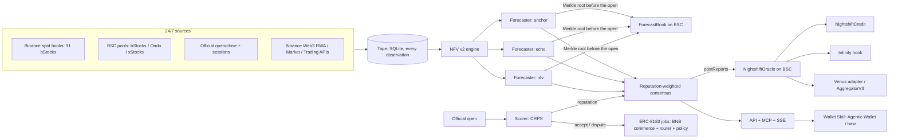

# Nightshift

**The price of a stock when Wall Street is asleep.**

Nightshift is a network of AI agents that prices tokenized US stocks on BNB Chain around the clock. Every round, each agent commits its forecast of the next market open on-chain. Reality scores them at the bell, they get paid only when they're right, and their consensus becomes a 24/7 oracle. That oracle powers what tokenized stocks can't do without it: trading that never overpays, borrowing against stocks on a Sunday, and AMM pools that can't be robbed at the open.

> Built for **BNB Hack: Tokenized Stocks Edition**. Centered on **bStocks** (91 tokens), with **Ondo** and **xStocks** priced and compared per real share. BSC mainnet.

---

## The problem

- **The real market sleeps most of the week.** Tokenized stocks trade 24/7, but deep price discovery only happens in the US regular session: 32.5 of 168 hours, or **19% of the week**. From Friday 20:00 to Sunday 20:00 New York time (**48 hours**, plus holidays and halts) there is **no reference price at all**.
- **Today's oracles either go stale or echo noise.** They report Friday's close, or a thin weekend print. That's why Venus accepts NVDAB/TSLAB/SPCXB as collateral yet keeps **borrow caps at zero** and a $200k weekend liquidation buffer.
- **"Which NVIDIA?"** The same company is NVDAB (bStocks), NVDAon (Ondo) and NVDAx (xStocks). Binance's own Agentic Wallet skill answers a bare "buy NVIDIA" by *asking the user which provider*. On Oct 8 premarket, the wrong choice cost **+83 bps per real share** (NVDAon $237.18 vs NVDAB $235.21).

## What we built

| Layer | What it is |
|---|---|
| **NFV, the science** | A dark-hours fair-value model ([whitepaper](docs/whitepaper.md)). **Information provenance:** a token's move since the close is split into post-market, dark and restart segments, and each segment's trust is learned. **Split-conformal 90% bands** for the next open. Backtested strictly out-of-sample on every gap since bStocks listed. |
| **The Night Shift, the agents** | Forecasters (`anchor`, `echo`, `nfv`, plus open slots), each with an **ERC-8004** identity. Every 30 minutes each one commits a Merkle root of its forecasts to **`ForecastBook`** before the open. The Scorer grades every forecast against the official open with CRPS (a score for probabilistic forecasts). Reputation-weighted consensus is posted to **`NightshiftOracle`**. |
| **Pay-for-accuracy** | **ERC-8183** jobs on BNB's live commerce, router and policy contracts. A forecaster is paid in U only if it beat the stale oracle; otherwise the Scorer disputes, with the score report's hash as evidence. |
| **Which NVIDIA?** | `/v1/which/NVDA` plus an MCP tool and a **Wallet Skill** for the Binance Agentic Wallet. It compares every issuer per real share across the Binance spot book and BSC pools, checks against fair value, then trades via `baw`: market inside the band, limit at fair value outside it. |
| **Credit** | `NightshiftCredit`: borrow USDT against bStocks 24/7. Collateral is valued at the **5th-percentile next-open price**, so a Sunday loan survives Monday's gap. Ships with a Venus `OracleInterface` adapter and Chainlink `AggregatorV3` feeds. |
| **Pools** | A PancakeSwap Infinity hook with dynamic LP fees from the oracle. Informed reopen flow pays for the gap it captures. |
| **API** | REST + SSE + OpenAPI + MCP: fair value, which, radar, rounds with Merkle proofs, live scoreboard, study. |

## Results

Strict leave-one-gap-out backtest over **70 gaps / 60,794 forecasts** (Jun 11 – Oct 7, 2026). CRPS in bps of price; lower is better.

| When the forecast is made | Stale oracle (last close) | On-chain echo | **Nightshift NFV** | 90% band coverage |
|---|---|---|---|---|
| All gaps | 165.2 | 129.9 | **128.6** (−22.1% vs stale) | 88.7% |
| Weekend, fully dark | 169.1 | 166.7 | **163.3** | 86.6% |
| Holiday, fully dark | 160.9 | 151.4 | **148.1** (−8.0%) | 89.6% |
| Sunday-night restart | 169.1 | 94.2 | **94.6** (−44.0%) | 89.0% |
| Weekday overnight | 162.6 | 112.3 | **112.0** (−31.2%) | 90.4% |

Two findings we didn't expect:
- **Weekend token prices are only weakly informative.** Echoing them mid-weekend can be *worse* than the stale close.
- **Company-specific after-hours moves carry into Monday in full** (learned weight 1.19), while market-wide weekend drift is ~55% noise (weight 0.46).

Live, forecasts are committed every round and scored at every open: `/v1/scoreboard`.

## Architecture



## Binance Web3 + BNB stack, and how we use it

| Module | Use | Unexpected use |
|---|---|---|
| RWA Data | registry, `tokenToShareRatio`, sessions, corporate actions | issuer-agnostic per-share pricing; corporate-action pause flags in oracle reports |
| Market | candles, pools, trades | 4 months of candles = the backtest; pools = per-venue liquidity for *which* |
| Trading | quotes, swaps, RFQ | quotes as 24/7 probes of executable price; RFQ windows (40367) as a session signal |
| Transaction | simulate, broadcast | execution proofs for receipts |
| b402 | pay-per-query fair value | the user's Agentic Wallet pays an oracle |
| Agentic Wallet + Skills | `baw` market/limit orders, x402 payment | a skill that turns "buy NVIDIA" into the cheapest real share at fair value |
| Agent Studio / `@bnbagent/sdk` | ERC-8004 identities, ERC-8183 jobs, keystores | pay-for-accuracy forecasting market with an independent scorer |

## Quick start

```bash
pnpm install
pnpm exec tsx packages/tape/src/backfill.ts && pnpm collect     # tape: history + 24/7 collector
pnpm exec tsx packages/network/src/runner.ts                   # the Night Shift: rounds, scoring, publishing
pnpm exec tsx packages/api/src/server.ts                       # API on :8787  (try /v1/which/NVDA)
```

Reproduce the science: `pnpm exec tsx packages/nfv/src/study-v2.ts`. Tests: `pnpm test`; contracts: `forge test` in `contracts/` and `contracts-hooks/`.

## Known limits

- The dark-hours point gain is real but modest (−3% to −8% CRPS). The value in the dark is mostly **calibrated uncertainty**, which is what a lender needs.
- About 17 weekends of history so far. The conformal bands undercover slightly in the weekend dark state (86.6% vs 90%), and are refit as live opens are scored.
- Reference opens and closes come from a public source in this build; production would use a licensed feed.
- Pre-IPO tokens (e.g. SpaceX) have no public reference and are excluded automatically: their ticker collides with unrelated listed securities.

## Repo

`packages/core` market calendar · `packages/feeds` public sources · `packages/tape` collector · `packages/nfv` model + study + live engine · `packages/network` rounds, Merkle, scorer, chain (ERC-8004/8183) · `packages/api` REST/SSE/MCP · `packages/sdk` Binance Web3 client · `contracts/` oracle, ForecastBook, credit · `contracts-hooks/` Infinity hook · `skills/nightshift` Wallet Skill · `docs/` whitepaper + specs.
