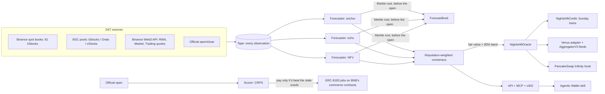

# Nightshift: the price of a stock when Wall Street is asleep

Nightshift is a 24/7 price oracle for tokenized stocks on BNB Chain, run by AI agents that get paid only when the opening bell proves them right.

- Each agent commits its forecast of every bStock's next US open on-chain before the market opens.
- The official open scores them, and ERC-8183 jobs are built to pay only the ones that beat a stale oracle.
- Their consensus, a fair value plus a calibrated 90% band, is what lending and trading contracts read at 3 a.m. on a Sunday.

**Live site: [nightshift-oracle.vercel.app](https://nightshift-oracle.vercel.app)**. It shows the night sky over Wall Street right now, the 91 bStocks priced for the next open, and every forecast sealed on BNB Chain. You can check any of them from your browser at [/verify](https://nightshift-oracle.vercel.app/verify).

> Built for **BNB Hack: Tokenized Stocks Edition**. **bStocks** are central (all 91 on BSC). **Ondo** and **xStocks** are priced per real share. BSC mainnet.

### Three facts, if you read nothing else

1. **It's live on BSC mainnet.** Forecast commitments, oracle reports and a loan against NVIDIA taken on a Sunday are on-chain. Every contract and transaction is linked from **[docs/LIVE.md](docs/LIVE.md)**, which is generated from the chain records.
2. **It's measured, not claimed.** In a strict out-of-sample backtest (70 gaps, 60,794 forecasts) the forecast error is **22% lower than a stale oracle's**. On live opens since Oct 8, scored automatically, it is **49% lower (Oct 8)** and **31% lower (Oct 9)**.
3. **It's built on the sponsor stack end to end:**
   - 7 Binance Web3 API modules, through our own 65-endpoint SDK;
   - a Wallet Skill for the Agentic Wallet (`baw` orders, x402);
   - an Agent Studio seller agent;
   - ERC-8004 identities and ERC-8183 jobs on BNB's own contracts.

### Verify it yourself in 3 minutes (no wallet, no signup)

0. Fastest: open **[/verify](https://nightshift-oracle.vercel.app/verify)** on the live site. Your browser fetches a forecast's Merkle proof, recomputes the leaf and root, and calls `ForecastBook.verifyForecast` on BSC itself.
1. Open **[docs/LIVE.md](docs/LIVE.md)** and click any **ForecastBook** commit. Its block time is before the 13:30 UTC open it forecasts.
2. Ask the API for one forecast and its Merkle proof: `GET /v1/rounds/{round}/proof/nfv/{token}`. Hash the leaf and check it against the root committed in step 1:
   ```
   keccak256(bytes.concat(keccak256(abi.encode(round, token, medianE8, lowerE8, upperE8, anchorTime))))
   ```
3. After the open, `GET /v1/scoreboard` shows the same forecasts scored against the official open.

---

## The problem

- **The stock market sets a real price only 19% of the week.**
  - Tokenized stocks trade 24/7, but deep price discovery happens in the US regular session: 32.5 of 168 hours.
  - From Friday 20:00 to Sunday 20:00 New York time (48 hours, plus holidays and halts) there is no reference price at all.
  - That is when people trade: bStocks launched on BNB Chain on June 11, 2026, and **62% of their July volume happened while US markets were dark** ([Crypto Briefing, Aug 26, 2026](https://cryptobriefing.com/binance-bstocks-volume-us-market-closures/)).
- **Oracles stop exactly then.** Chainlink's tokenized-equity docs: *"These feeds do not publish updates, including heartbeat updates, while markets are closed"* ([docs](https://docs.chain.link/data-feeds/tokenized-equity-feeds)). A lender sees Friday's close all weekend and can't size a loan against Monday's gap.
- **So lending stays switched off.** Venus listed NVDAB, TSLAB and SPCXB as collateral with *"Borrow cap: 0 (borrowing disabled)"* ([proposal, June 2026](https://community.venus.io/t/bnb-chain-list-vtslab-vnvdab-and-vspcxb-markets-in-the-venus-core-pool/5832)). Our year of weekend gaps says solvency isn't the constraint ([report](docs/venus-weekend-risk.md)); a price for the dark hours is.

## How it works



1. **Forecast.** Every 30 minutes, three forecasters (each with an ERC-8004 identity) predict every bStock's next official open as a distribution, not a point:
   - `anchor`: today's oracle, the last close;
   - `echo`: the live on-chain price;
   - `nfv`: our model.
2. **Commit.** Each forecaster commits a Merkle root of its forecasts to `ForecastBook` before the open. Nobody, including us, can change a forecast after the fact.
3. **Score and pay.** At the open, the Scorer grades every forecast with CRPS, a standard score for probabilistic forecasts. ERC-8183 jobs on BNB's commerce, router and policy contracts escrow the forecasters' pay in U:
   - a forecaster is paid only if it beat the stale oracle on that open;
   - otherwise the Scorer disputes, with the score report's hash as evidence.
4. **Publish.** The reputation-weighted consensus goes to `NightshiftOracle` as a fair value plus a 90% band for the next open.
   - Tokens that contracts consume are posted every round.
   - The rest are posted on a 25 bps move or a 6-hour heartbeat, so gas lasts through judging.
5. **Use.** Contracts read the band, not just the price.

## What we built

| Piece | What it is |
|---|---|
| **NFV model** | Dark-hours fair value ([whitepaper](docs/whitepaper.md)). **Information provenance**: a token's move since the close is split into post-market, dark and restart segments, and each segment's trust is learned. Split-conformal 90% bands. Backtested strictly out-of-sample on every gap since bStocks listed. |
| **Pay-for-accuracy network** | `ForecastBook` commit-reveal, CRPS Scorer, ERC-8183 job lifecycle (open → submit the last on-chain root → judge → settle) run by the runner with no human in the loop. |
| **NightshiftOracle** | Signed fair value + band + session + flags per token; staleness and corporate-action flags; Chainlink `AggregatorV3` feeds per token. |
| **NightshiftCredit** | Borrow USDT against bStocks 24/7. Collateral counts at the **lower edge of the band** for the next open, so a Sunday loan is sized for Monday's gap. Ships a Venus `OracleInterface` adapter. |
| **Infinity hook** | PancakeSwap Infinity dynamic-fee hook driven by the oracle. Informed reopen flow pays for the gap it captures. On a BSC mainnet fork (pool $230, fair value $236, ~$302k position), LPs lose **$70.63** with Nightshift vs **$244.92** at a flat 0.05% fee and **$207.81** at a flat 0.25%: **71% and 66% lower** ([hook.md](docs/hook.md)). |
| **Wallet Skill** | `skills/nightshift` for the Binance Agentic Wallet: per-real-share prices across bStocks, Ondo and xStocks, fair-value checks, `baw` market orders inside the band and limit orders at fair value outside it, and x402 for paid data. |
| **Receipts** | `/v1/receipts/{tx}` turns any BSC tokenized-stock trade into its cost per real share against the fair value at that moment, rebuilt from on-chain logs and hashed. A real $2,451 NVDAB sale "sold 11.1 bps below fair value". |
| **Agent Studio seller** | `agents/NightshiftOracle` (`bag init`, BSC mainnet, A2A + MCP + x402, ERC-8183 + B402 rails) sells deterministic fair-value reports to other agents. |
| **Binance Web3 SDK** | `packages/sdk` covers all **65 REST endpoints**, with:<br>• HMAC signing and clock-skew correction<br>• per-endpoint rate limits and circuit breakers<br>• never-retry-writes, record/replay, and a b402 merchant kit<br>• telemetry on every call<br>It found **40 documentation issues** ([README](packages/sdk/README.md)). |
| **API** | REST + SSE + OpenAPI + MCP: fair value, rounds with Merkle proofs, scoreboard, receipts, radar, identities, health. |

## Results

Strict leave-one-gap-out backtest over **70 gaps / 60,794 forecasts** (Jun 11 – Oct 7, 2026). CRPS in bps of price; lower is better.

| When the forecast is made | Stale oracle (last close) | On-chain echo | **Nightshift NFV** | 90% band coverage |
|---|---|---|---|---|
| All gaps | 165.2 | 129.9 | **128.6** (−22.1% vs stale) | 88.7% |
| Weekend, fully dark | 169.1 | 166.7 | **163.3** | 86.6% |
| Holiday, fully dark | 160.9 | 151.4 | **148.1** (−8.0%) | 89.6% |
| Sunday-night restart | 169.1 | 94.2 | **94.6** (−44.0%) | 89.0% |
| Weekday overnight | 162.6 | 112.3 | **112.0** (−31.2%) | 90.4% |

**Live**, every official open scored automatically (forecasts committed in the pre-open rounds):

| Open | Forecasts | Stale oracle | On-chain echo | **NFV** | NFV 90% band coverage |
|---|---|---|---|---|---|
| Oct 8, 2026 | 261 | 120.8 | 61.9 | **61.7** (−49%) | 96.6% |
| Oct 9, 2026 | 3,045 | 148.6 | 103.6 | **102.9** (−31%) | 85.2% |

Two findings we didn't expect:
- **Weekend token prices are only weakly informative.** Echoing them mid-weekend can be worse than the stale close.
- **Company-specific after-hours moves carry into Monday in full** (learned weight 1.19). Market-wide weekend drift is about 55% noise (weight 0.46).

## What's real

| Live on BSC mainnet | Built and tested, not live | Designed |
|---|---|---|
| ForecastBook commits, oracle reports, AggregatorV3 feeds, ERC-8004 identities, the Sunday loan, an Agentic Wallet buy with its receipt, 24/7 collector and scoring, Binance Web3 API feeds, the website ([LIVE.md](docs/LIVE.md)) | ERC-8183 pay-for-accuracy jobs (create, fund, submit, judge, reclaim; the first open once the escrow holds U), Infinity hook (71 Foundry tests, 7 on a mainnet fork), Venus adapter (deployed; Venus itself doesn't read it) | Third-party forecasters joining the network; licensed reference data |

## Known limits

- **The dark-hours point gain is modest** (−3% to −8% CRPS). The value in the dark is mostly calibrated uncertainty, which is what a lender needs.
- **The bands undercover slightly.** That's 86.6% in the weekend-dark backtest and 85.2% on the Oct 9 open, against a 90% target. They are refit as live opens are scored.
- **No forecaster has been paid yet.** Scores are published every open; ERC-8183 jobs start once the escrow is funded with U.
- **About 17 weekends of history** exist so far.
- **Reference opens and closes come from a public source** in this build. Production would use a licensed feed.
- **Pre-IPO tokens are excluded automatically** (SpaceX, Cerebras, Quantinuum): they have no public reference, and their tickers collide with unrelated listed securities.

## Binance Web3 + BNB stack, and how we use it

| Module | Use | Unexpected use |
|---|---|---|
| RWA Data | registry, `tokenToShareRatio`, market status, corporate actions | issuer-agnostic per-share pricing; corporate-action pause flags inside oracle reports |
| Market | candles, pools, trades | 4 months of candles = the backtest; pools = per-venue liquidity |
| Trading | quotes, swaps, RFQ | a $100 / $1k / $10k quote ladder as a 24/7 probe of executable price; RFQ refusals as a session signal |
| Transaction | broadcast with MEV protection | execution proofs for receipts |
| b402 | pay-per-query fair value | an Agentic Wallet pays an oracle |
| Agentic Wallet + Skills | `baw` orders, x402 payment | a skill that turns "buy NVIDIA" into the cheapest real share at fair value |
| Agent Studio / `@bnbagent/sdk` | ERC-8004 identities, ERC-8183 jobs | a pay-for-accuracy forecasting market with an independent scorer |

## Quick start

```bash
pnpm install
pnpm exec tsx packages/tape/src/backfill.ts && pnpm collect     # tape: history + 24/7 collector
pnpm exec tsx packages/network/src/runner.ts                   # the Night Shift: rounds, scoring, publishing
pnpm exec tsx packages/api/src/server.ts                       # API on :8787
```

- Reproduce the science: `pnpm exec tsx packages/nfv/src/study-v2.ts`.
- Regenerate the live proof page: `pnpm exec tsx scripts/live-proof.ts`.
- Hosting: the website is static on Vercel's edge (`apps/web/scripts/vercel-output.mjs`, `pnpm --filter @nightshift/web vercel`), and one Railway service runs the engine, the database and the API (`railway.json`, `deploy/railway/`). Vercel proxies `/v1`, `/x402`, `/mcp` and `/.well-known` to it, so everything answers on one domain.

Tests:
- `pnpm test`: TypeScript tests (calendar, CRPS closed forms vs numerical integration, provenance segment bounds incl. DST and holidays, Merkle commitments, receipts, oracle posting policy, plus the SDK's 110).
- `forge test` in `contracts-hooks/`: 71 tests, 7 of them on a BSC mainnet fork against PancakeSwap's live Infinity contracts.
- `forge test` in `contracts/`: oracle, ForecastBook, credit, with fuzz, invariant and fork tests.

## Repo

| Path | What's in it |
|---|---|
| `packages/core` | market calendar |
| `packages/feeds` | public sources |
| `packages/tape` | 24/7 collector |
| `packages/nfv` | model, study and live engine |
| `packages/network` | rounds, Merkle, scorer, chain (ERC-8004/8183) |
| `packages/api` | REST, SSE and MCP |
| `packages/sdk` | Binance Web3 client |
| `packages/trade` | executor and receipts |
| `contracts/` | oracle, ForecastBook, credit |
| `contracts-hooks/` | Infinity hook |
| `agents/NightshiftOracle` | Agent Studio seller |
| `skills/nightshift` | Wallet Skill |
| `docs/` | whitepaper, specs, live proof |
